<p align="center">
  
</p>

# Koopman-MPC Quadrotor Simulation in MuJoCo

> **How to read this README:** Start with the project overview and simulation workflow, then use the file guide and controller explanations to understand how the code fits together. The comparison gallery later in this document contains the saved experiments; each figure is labeled by terrain, payload fraction, and wind magnitude.

## What this project does

This project studies how an autonomous Crazyflie $2.\mathrm{X}$ quadrotor follows a dynamic $3\mathrm{D}$ spatial trajectory while traversing complex terrain whose height continuously changes. The simulation uses the **MuJoCo** physics engine to compute the rigid-body equations of motion, rotor aerodynamics, gravity vector, and surface contact dynamics. High-level Python control loops supply the reference path, observe the continuous state vector $x_k \in \mathbb{R}^{18}$, optimize motor actuator setpoints $\mathrm{RPM}_i \in [0, \mathrm{RPM}_{\max}]$, and log closed-loop tracking metrics.

<p align="center">
  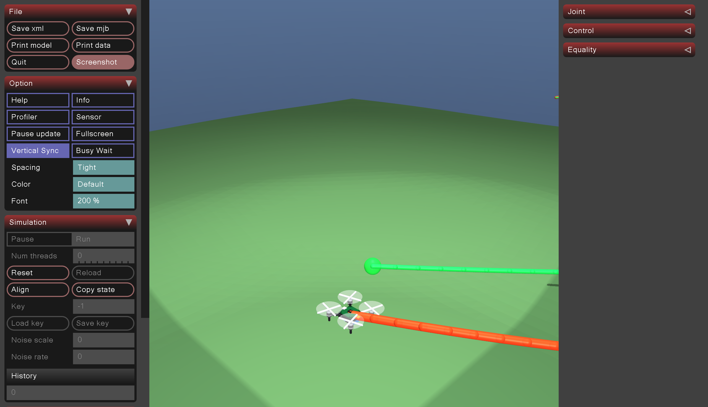
</p>

<p align="center"><em>Figure 1: Interactive MuJoCo simulation environment: the Crazyflie quadrotor is rendered over 3D heightfield terrain with active flight path tracking and reference ribbons.</em></p>

The central controller is **Data-Driven Koopman Model Predictive Control (Koopman-MPC)**. Rather than approximating drone dynamics via local linearization or solving computationally prohibitive non-linear programs (NLP) online, the system represents state transitions in an expanded Hilbert observable space via a lifting mapping:

$$\psi(x): \mathbb{R}^{18} \to \mathbb{R}^{27}$$

A global linear state transition operator $(A, B)$ is fitted to empirical transition pairs using Extended Dynamic Mode Decomposition (EDMD). At each sampling interval $\Delta t_{\text{control}} = \frac{1}{48}\,\text{s}$, the MPC solves a convex Quadratic Program (QP) over a prediction horizon $H_p = 10$, enforcing motor velocity bounds while minimizing spatial tracking error and control increments. Applying a receding-horizon policy, only the first action $u_0^*$ is executed before the cycle repeats.

The benchmark suite evaluates performance against two classical control architectures:
- **PID:** A cascaded Proportional-Integral-Derivative controller converting outer-loop position errors into virtual acceleration vectors, mapped to rotor speeds through an inner attitude/angular rate loop and thrust mixer.
- **LQR:** A discrete-time Linear-Quadratic Regulator operating on decomposed double-integrator dynamics with Riccati-derived state-feedback gain matrices $K_{\text{lqr}}$ and integral trim compensation.
- **Koopman-MPC:** A predictive controller using the lifted observable model $\psi(x)$ and convex QP optimization under motor saturation constraints.

### Simulation loop at a glance

```text
Terrain Heightfield + XML Drone Model
                 │
                 ▼
MuJoCo State: p_k in R^3, v_k in R^3, R_k in SO(3), omega_k in R^3 (18-dim)
                 │
                 ▼
Reference Trajectory: p_ref(t) = [x_ref(t), y_ref(t), h_ground(x,y) + h_target]
                 │
                 ▼
Controller: PID, LQR, or Koopman-MPC
                 │
                 ▼
Motor Actuation: 4 rotor commands RPM_i in [0, RPM_max]
                 │
                 ▼
MuJoCo Physics Step: dt_physics = 1/240 s (5 substeps per control interval)
                 │
                 ├───────► Record: p_k, e_k, h_AGL(t), RPM_i
                 │
                 └───────► Repeat until episode duration T is reached
```

The underlying XML model defines drone inertia, motor actuators, and terrain collision meshes. `mujoco_quad_env.py` bridges MuJoCo with Python controllers, `terrain.py` generates procedural height fields, `run_koopman_mujoco.py` executes Koopman-MPC flights, `run_sim.py` benchmarks the controllers, and `drone_sim.py` provides an interactive GUI.

---

## Project files and how they work together

All paths below are relative to the `mujoco/` directory:

| File | Role in the complete workflow |
|---|---|
| `cf2x_terrain.xml` | Main MuJoCo scene definition: Crazyflie $2.\mathrm{X}$ airframe, motors, heightfield terrain, and camera configurations. |
| `mjmodel.xml` | Compiled MuJoCo model cache and asset descriptor. |
| `mujoco_quad_env.py` | Python simulation interface: loads XML, sets physics frequencies, exposes state $x_k \in \mathbb{R}^{18}$, injects disturbances, and computes clearance $h_{\text{AGL}}$. |
| `terrain.py` | Procedural heightfield generation supporting 8 distinct mathematical terrain topologies. |
| `koopman_mpc.py` | Implements lifting mapping $\psi(x)$, gathers training data, fits $(A, B)$ via ridge regression, and solves receding-horizon QP via CLARABEL. |
| `controllers.py` | Implements classical cascaded PID and discrete LQR baselines with rotor mixing algorithms. |
| `run_koopman_mujoco.py` | Executes Koopman-MPC flights with live trajectory trails, disturbance injection, and `.npz` logging. |
| `run_sim.py` | Benchmarks PID, LQR, and Koopman-MPC sequentially on identical terrain and exports `comparison.png`. |
| `run_pid_mujoco.py`, `run_lqr_mujoco.py` | Standalone test runners for individual baseline controllers. |
| `drone_sim.py` | Real-time interactive flight dashboard with terrain selectors and disturbance sliders. |
| `selftest.py` | Verifies motor thrust directions, terrain elevation lookups, and collision detection. |
| `test_koopman_base_in_mujoco.py` | Validates loaded Koopman model matrices $A \in \mathbb{R}^{27 \times 27}, B \in \mathbb{R}^{27 \times 4}$. |
| `analysis/run_batch_comparisons.py` | Batch generator evaluating a $4 \times 3 \times 3$ grid of simulation conditions ($36$ comparison figures). |
| `analysis/comparisons/` | Storage repository for all $36$ empirical four-panel comparison figures. |

---

## The simulation model

### Physics and timing

The quadrotor mass is $m = 0.027\,\text{kg}$ with standard gravitational acceleration $g = 9.8\,\text{m/s}^2$. MuJoCo integrates rigid-body equations at a physics frequency of $f_{\text{physics}} = 240\,\text{Hz}$:

$$\Delta t_{\text{physics}} = \frac{1}{240}\,\text{s} \approx 0.00417\,\text{s}$$

Control decisions are evaluated at $f_{\text{control}} = 48\,\text{Hz}$, holding each actuator command over $n_{\text{sub}} = 5$ physics substeps:

$$\Delta t_{\text{control}} = 5 \times \Delta t_{\text{physics}} = \frac{5}{240} = \frac{1}{48}\,\text{s} \approx 0.02083\,\text{s}$$

### State vector

The environment state vector $x_k \in \mathbb{R}^{18}$ is structured as:

$$x_k = \begin{bmatrix} p_k \\ v_k \\ \operatorname{vec}(R_k) \\ \omega_k \end{bmatrix} \in \mathbb{R}^{18}$$

where:
- $p_k = [x_k, y_k, z_k]^\top \in \mathbb{R}^3$ is world-frame inertial position.
- $v_k = [\dot{x}_k, \dot{y}_k, \dot{z}_k]^\top \in \mathbb{R}^3$ is linear velocity in world coordinates.
- $R_k \in SO(3) \subset \mathbb{R}^{3 \times 3}$ is the body-to-world rotation matrix flattened in row-major order:
  $$\operatorname{vec}(R_k) = [R_{xx}, R_{xy}, R_{xz}, R_{yx}, R_{yy}, R_{yz}, R_{zx}, R_{zy}, R_{zz}]^\top \in \mathbb{R}^9$$
- $\omega_k = [\omega_x, \omega_y, \omega_z]^\top \in \mathbb{R}^3$ is the angular velocity vector.

Total state dimensionality: $3 + 3 + 9 + 3 = 18$.

### Motor dynamics and thrust mapping

Each rotor generates aerodynamic thrust proportional to the square of its rotational speed:

$$T_i = k_f \, \mathrm{RPM}_i^2, \quad i \in \{1, 2, 3, 4\}$$

where $k_f = 3.16 \times 10^{-10}\,\text{N}\cdot\text{s}^2/\text{rad}^2$. Rotor commands are strictly constrained:

$$0 \le \mathrm{RPM}_i \le \mathrm{RPM}_{\max}, \quad \mathrm{RPM}_{\max} = 21{,}703\,\text{RPM}$$

The theoretical nominal hover speed supporting total vehicle weight $m g$ is:

$$\mathrm{RPM}_{\text{hover}} = \sqrt{\frac{m g}{4 k_f}} = \sqrt{\frac{0.027 \times 9.8}{4 \times 3.16 \times 10^{-10}}} \approx 14{,}468\,\text{RPM}$$

### Terrain heightfield and Above-Ground-Level (AGL)

A continuous surface height function $h_{\text{ground}}(x, y)$ is evaluated across the $x$-$y$ plane. The reference altitude tracking profile is defined by:

$$z_{\text{ref}}(t) = h_{\text{ground}}\big(x_{\text{ref}}(t), y_{\text{ref}}(t)\big) + h_{\text{target}}$$

where $h_{\text{target}} = 1.5\,\text{m}$. To prevent physically infeasible reference step-changes over vertical walls, $\dot{z}_{\text{ref}}$ is rate-limited.

The vehicle's true clearance above ground level is:

$$h_{\text{AGL}}(t) = z(t) - h_{\text{ground}}\big(x(t), y(t)\big)$$

Safe terrain navigation requires:

$$h_{\text{AGL}}(t) > 0, \quad \forall t \ge 0$$

### Payload and wind disturbance models

Disturbances are systematically injected to benchmark robustness:
- **Payload Disturbance:** Total mass scales by factor $(1 + \delta_m)$ where $\delta_m \in \{0.0, 0.20, 0.40\}$ ($+0\%$, $+20\%$, $+40\%$ cargo load), introduced at $t = 3\,\text{s}$:
  $$m_{\text{dist}} = m \times (1 + \delta_m)$$
- **Wind Gust Disturbance:** Horizontal force $F_{\text{wind}} \in \{0.0\,\text{N}, 0.015\,\text{N}, 0.03\,\text{N}\}$ applied during the gust window $t \in [3\,\text{s}, 5\,\text{s}]$:
  $$F_w = \begin{bmatrix} F_{\text{wind}} \cos(\theta_w) \\ F_{\text{wind}} \sin(\theta_w) \\ 0 \end{bmatrix}$$

---

## The three controllers

### 1. Cascaded PID controller

The PID baseline computes desired virtual accelerations from tracking errors:

$$e_p(t) = p_{\text{ref}}(t) - p(t), \qquad e_v(t) = v_{\text{ref}}(t) - v(t)$$

$$a_{\text{cmd}}(t) = K_p \, e_p(t) + K_d \, e_v(t) + K_i \int_0^t e_p(\tau) \, d\tau$$

The desired acceleration vector $a_{\text{cmd}}$ is converted into total thrust and desired roll/pitch angles $(\phi_{\text{des}}, \theta_{\text{des}})$. Inner attitude and rate loops generate three-axis control moments $(M_x, M_y, M_z)$, which are distributed to rotor RPMs via the standard quadrotor mixer matrix.

### 2. Cascaded LQR controller

The LQR design models translational error dynamics as decoupled discrete double integrators:

$$q_{k+1} = A_{\text{lqr}} q_k + B_{\text{lqr}} a_k, \qquad q_k = \begin{bmatrix} e_k \\ \dot{e}_k \end{bmatrix} \in \mathbb{R}^2$$

$$A_{\text{lqr}} = \begin{bmatrix} 1 & \Delta t \\ 0 & 1 \end{bmatrix}, \qquad B_{\text{lqr}} = \begin{bmatrix} \frac{1}{2} \Delta t^2 \\ \Delta t \end{bmatrix}$$

The optimal state feedback gain $K_{\text{lqr}}$ minimizes the quadratic cost functional:

$$J_{\text{lqr}} = \sum_{k=0}^{\infty} \left( q_k^\top Q_{\text{lqr}} q_k + a_k^\top R_{\text{lqr}} a_k \right)$$

Solving the Discrete Algebraic Riccati Equation (DARE):

$$P = Q_{\text{lqr}} + A_{\text{lqr}}^\top P A_{\text{lqr}} - A_{\text{lqr}}^\top P B_{\text{lqr}} (R_{\text{lqr}} + B_{\text{lqr}}^\top P B_{\text{lqr}})^{-1} B_{\text{lqr}}^\top P A_{\text{lqr}}$$

$$K_{\text{lqr}} = (R_{\text{lqr}} + B_{\text{lqr}}^\top P B_{\text{lqr}})^{-1} B_{\text{lqr}}^\top P A_{\text{lqr}}$$

An auxiliary integrator trims steady-state altitude offsets under load.

### 3. Koopman-MPC controller

#### Nonlinear state lifting

The $18$-dimensional physical state $x_k$ is mapped into a $27$-dimensional lifted observable vector:

$$\psi(x) = \begin{bmatrix} x \\ v_x R_{zz} \\ v_y R_{zz} \\ v_z R_{zz} \\ v_z R_{xz} \\ v_z R_{yz} \\ \omega_x R_{zz} \\ \omega_y R_{zz} \\ \omega_z R_{zz} \\ 1 \end{bmatrix} \in \mathbb{R}^{27}$$

The non-linear bilinear products couple translational velocity and body rates with the vertical projection element of the rotation matrix $R_{zz} = \cos(\theta)\cos(\phi)$, linearizing attitude-thrust interactions.

#### EDMD predictor estimation

Data transitions $\{(\psi(x_k), u_k, \psi(x_{k+1}))\}_{k=1}^M$ are collected across diverse flight envelopes. Normalized inputs are defined as:

$$u_k = \frac{\mathrm{RPM}_k - \mathrm{RPM}_{\text{hover}}}{\mathrm{RPM}_{\text{hover}}} \in \mathbb{R}^4$$

Ridge-regularized least-squares regression estimates $(A, B)$:

$$\Theta^* = \arg\min_\Theta \left( \| Y - Z \Theta \|_F^2 + \lambda \|\Theta\|_F^2 \right)$$

where $Z = [\Psi(X_0), \, U]$, $Y = \Psi(X_1)$, yielding:

$$\psi(x_{k+1}) \approx A \psi(x_k) + B u_k, \qquad A \in \mathbb{R}^{27 \times 27}, \quad B \in \mathbb{R}^{27 \times 4}$$

#### Receding-horizon quadratic program

At each control step, the MPC solves:

$$\min_{\{\Delta u_t\}_{t=0}^{H_p-1}} \sum_{t=0}^{H_p-1} \left( \|\psi_{t+1} - \psi_{\text{ref}, t+1}\|_Q^2 + \|\Delta u_t\|_{R_m}^2 + \|\Delta u_t - \Delta u_{t-1}\|_{E_m}^2 \right)$$

$$\text{subject to:} \quad \psi_{t+1} = A \psi_t + B u_t$$

$$u_t = u_{\text{hover}} + \Delta u_t$$

$$-u_{\text{hover}} \le \Delta u_t \le \mathrm{RPM}_{\max} - u_{\text{hover}}$$

$$\Delta u_t = \Delta u_{H_c-1}, \quad \forall t \ge H_c$$

with prediction horizon $H_p = 10$, control horizon $H_c = 5$, solved via `CLARABEL`.

#### Adaptive collective hover trim

To reject payload mass uncertainty $\delta_m$, an adaptive baseline is integrated:

$$a_{z, \text{cmd}} = g + K_{p, z} (z_{\text{ref}} - z) + K_{d, z} (\dot{z}_{\text{ref}} - \dot{z}) + K_{i, z} \int_0^t (z_{\text{ref}} - z) \, d\tau$$

$$T_{\text{cmd}} = m \max(a_{z, \text{cmd}}, 2.0)$$

$$\mathrm{RPM}_{\text{hover}} = \sqrt{\frac{T_{\text{cmd}}}{4 k_f}}$$

---

## Installation

### Requirements
- Python $3.10$ or $3.11$
- `numpy`, `mujoco`, `cvxpy`, `clarabel`, `scipy`, `pandas`, `matplotlib`

### Windows (PowerShell / Command Prompt)

```powershell
cd mujoco
py -3.10 -m venv .venv
.\.venv\Scripts\Activate.ps1
python -m pip install --upgrade pip
python -m pip install numpy mujoco cvxpy clarabel scipy pandas matplotlib
```

### Linux or macOS

```bash
cd mujoco
python3.10 -m venv .venv
source .venv/bin/activate
python -m pip install --upgrade pip
python -m pip install numpy mujoco cvxpy clarabel scipy pandas matplotlib
```

### Verification
```bash
python selftest.py
```

---

## Run the simulations

To run any simulation, open your terminal, navigate to the `mujoco/` directory, and activate your virtual environment:

```cmd
cd /d D:\Drones_S5_CD7-Koopman\mujoco
```

### 1. Live 3D flight of Koopman-MPC over rolling terrain
Launches the real-time $3\mathrm{D}$ MuJoCo passive viewer with a dynamic camera tracking the Crazyflie as it follows an elliptical sinusoidal reference trajectory over undulating terrain:
```cmd
python run_koopman_mujoco.py --gui --terrain rolling
```

### 2. Test disturbance rejection ($+20\%$ payload mass, $90^\circ$ crosswind)
Evaluates robustness by injecting a $+20\%$ mass increase ($\delta_m = 0.20$) at $t = 3\,\text{s}$ and applying a sustained horizontal crosswind force $F_{\text{wind}} = 0.015\,\text{N}$ along $+\hat{y}$ ($\theta_w = 90^\circ$) from $t = 3\,\text{s}$ to $t = 6\,\text{s}$:
```cmd
python run_koopman_mujoco.py --gui --terrain rolling --payload 0.20 --wind 0.015 --wind-dir 90
```

### 3. Test on steep mountain peaks
Challenges tracking and vertical authority over rugged elevation profiles with sharp gradients:
```cmd
python run_koopman_mujoco.py --gui --terrain mountain
```

### 4. Run the 3-controller benchmark (generates `comparison.png`)
Executes Cascaded PID, Linear LQR, and Koopman-MPC sequentially on identical terrain and disturbances, printing comparative $\mathrm{RMSE}$, $e_{\max}$, and $\mathrm{AGL}_{\min}$, and saving a 4-panel figure:
```cmd
python run_sim.py --ctrl all --gui --terrain rolling
```

### 5. Launch interactive flight dashboard with real-time sliders
Opens an interactive control dashboard allowing dynamic tuning of wind vectors, payload mass, target clearance, and terrain selection with live state telemetry:
```cmd
python drone_sim.py --terrain rolling
```

---

## Quantitative benchmark metrics

Tracking performance is evaluated using three rigorous statistical metrics:

1. **Instantaneous 3D Tracking Error:**
   $$e_k = \| p_k - p_k^{\text{ref}} \|_2 = \sqrt{(x_k - x_k^{\text{ref}})^2 + (y_k - y_k^{\text{ref}})^2 + (z_k - z_k^{\text{ref}})^2}$$

2. **Root Mean Square Error (RMSE):**
   $$\mathrm{RMSE} = \sqrt{\frac{1}{N} \sum_{k=1}^N e_k^2}$$

3. **Maximum Tracking Deviation:**
   $$e_{\max} = \max_{1 \le k \le N} e_k$$

4. **Minimum Terrain Clearance:**
   $$\mathrm{AGL}_{\min} = \min_{1 \le k \le N} h_{\text{AGL}, k}$$

---

## The 36 saved comparison figures

Batch evaluation across $4\text{ terrains} \times 3\text{ payloads} \times 3\text{ winds}$ produces a complete $36$-scenario benchmark matrix:
- **Terrains:** `canyon`, `flat`, `mountain`, `rolling`
- **Payload fractions:** $\delta_m \in \{0.0, 0.20, 0.40\}$ ($+0\%$, $+20\%$, $+40\%$ mass)
- **Wind forces:** $F_w \in \{0.0\,\text{N}, 0.015\,\text{N}, 0.03\,\text{N}\}$ applied for $t \in [3\,\text{s}, 5\,\text{s}]$

### Canyon terrain

<details>
<summary><strong>comparison_canyon_payload0.0_wind0.0.png</strong> — Nominal mass ($\delta_m = 0.0$), $F_w = 0.0\,\text{N}$</summary>

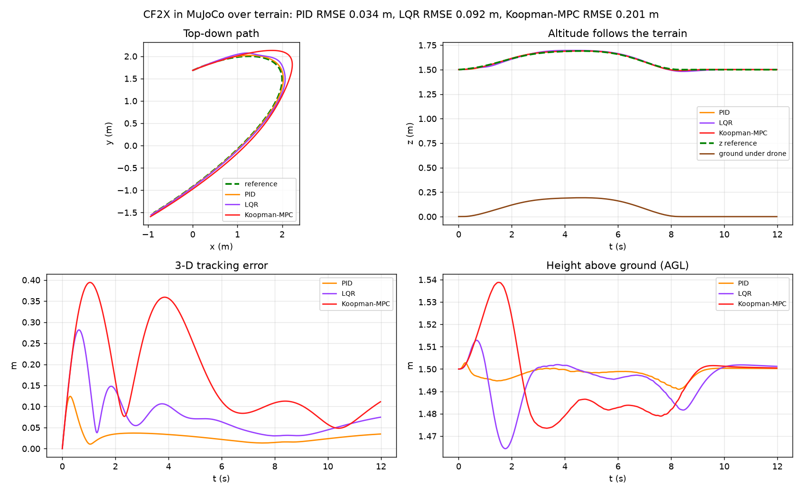

**Conditions:** $\delta_m = 0.0$, $F_w = 0.0\,\text{N}$.
**Results:** $\text{RMSE}_{\text{PID}} = 0.034\,\text{m}$, $\text{RMSE}_{\text{LQR}} = 0.092\,\text{m}$, $\text{RMSE}_{\text{Koopman-MPC}} = 0.201\,\text{m}$.
</details>

<details>
<summary><strong>comparison_canyon_payload0.0_wind0.015.png</strong> — Nominal mass ($\delta_m = 0.0$), $F_w = 0.015\,\text{N}$</summary>

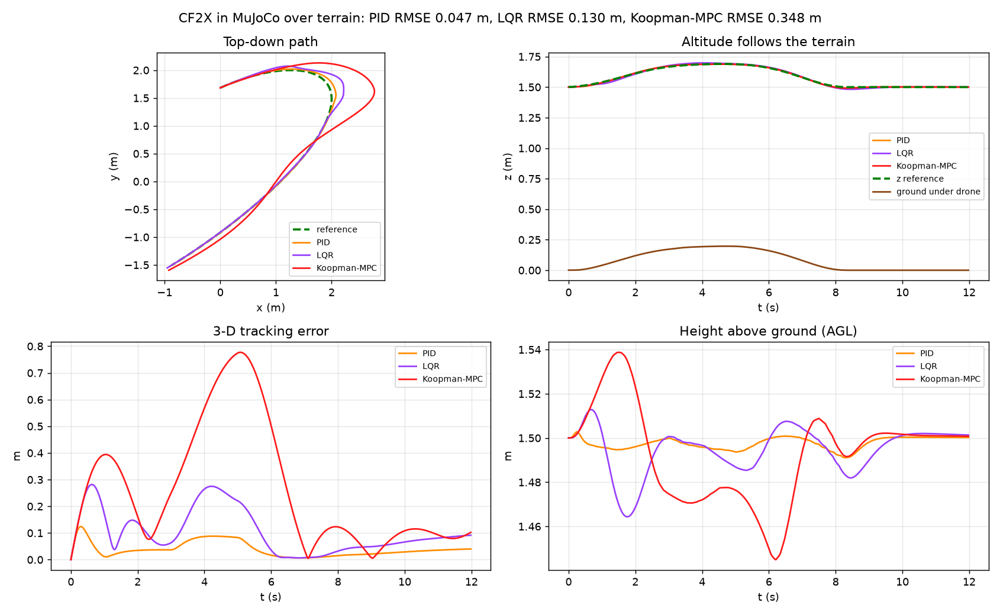

**Conditions:** $\delta_m = 0.0$, $F_w = 0.015\,\text{N}$ ($t \in [3\,\text{s}, 5\,\text{s}]$).
**Results:** $\text{RMSE}_{\text{PID}} = 0.047\,\text{m}$, $\text{RMSE}_{\text{LQR}} = 0.130\,\text{m}$, $\text{RMSE}_{\text{Koopman-MPC}} = 0.348\,\text{m}$.
</details>

<details>
<summary><strong>comparison_canyon_payload0.0_wind0.03.png</strong> — Nominal mass ($\delta_m = 0.0$), $F_w = 0.03\,\text{N}$</summary>

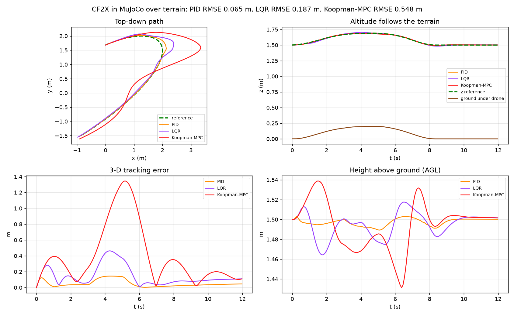

**Conditions:** $\delta_m = 0.0$, $F_w = 0.03\,\text{N}$.
**Results:** $\text{RMSE}_{\text{PID}} = 0.065\,\text{m}$, $\text{RMSE}_{\text{LQR}} = 0.187\,\text{m}$, $\text{RMSE}_{\text{Koopman-MPC}} = 0.548\,\text{m}$.
</details>

<details>
<summary><strong>comparison_canyon_payload0.2_wind0.0.png</strong> — $+20\%$ mass ($\delta_m = 0.20$), $F_w = 0.0\,\text{N}$</summary>

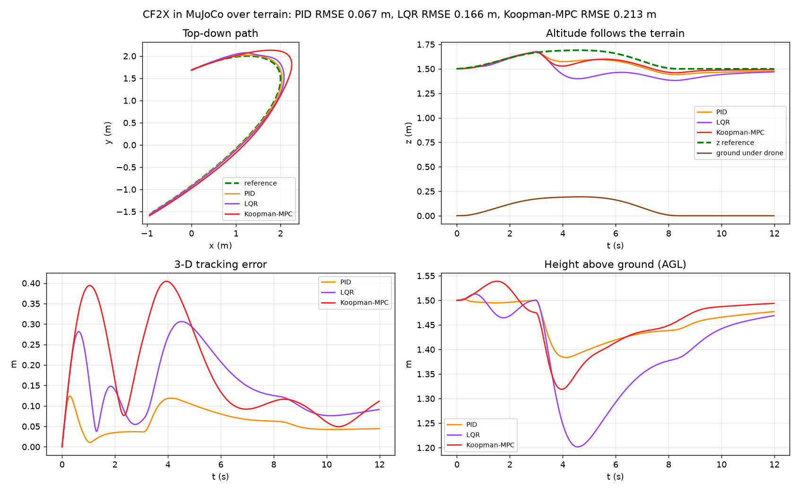

**Conditions:** $\delta_m = 0.20$ at $t = 3\,\text{s}$, $F_w = 0.0\,\text{N}$.
**Results:** $\text{RMSE}_{\text{PID}} = 0.067\,\text{m}$, $\text{RMSE}_{\text{LQR}} = 0.166\,\text{m}$, $\text{RMSE}_{\text{Koopman-MPC}} = 0.213\,\text{m}$.
</details>

<details>
<summary><strong>comparison_canyon_payload0.2_wind0.015.png</strong> — $+20\%$ mass ($\delta_m = 0.20$), $F_w = 0.015\,\text{N}$</summary>

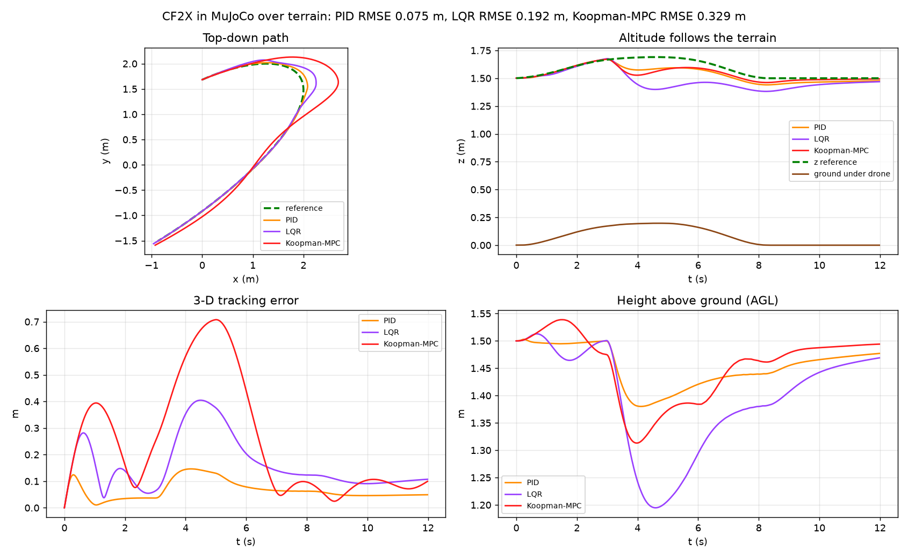

**Conditions:** $\delta_m = 0.20$, $F_w = 0.015\,\text{N}$.
**Results:** $\text{RMSE}_{\text{PID}} = 0.075\,\text{m}$, $\text{RMSE}_{\text{LQR}} = 0.192\,\text{m}$, $\text{RMSE}_{\text{Koopman-MPC}} = 0.329\,\text{m}$.
</details>

<details>
<summary><strong>comparison_canyon_payload0.2_wind0.03.png</strong> — $+20\%$ mass ($\delta_m = 0.20$), $F_w = 0.03\,\text{N}$</summary>

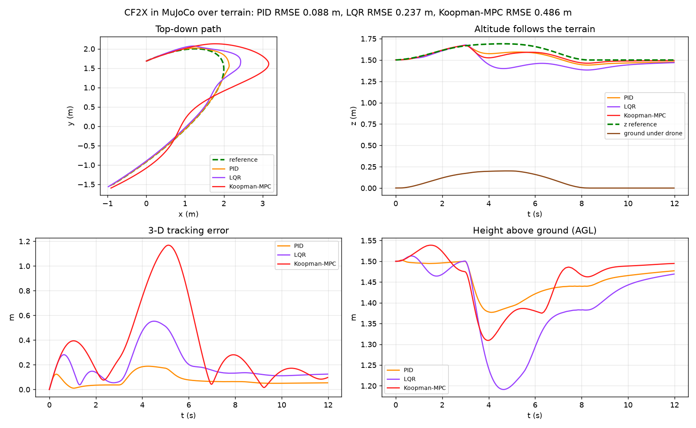

**Conditions:** $\delta_m = 0.20$, $F_w = 0.03\,\text{N}$.
**Results:** $\text{RMSE}_{\text{PID}} = 0.088\,\text{m}$, $\text{RMSE}_{\text{LQR}} = 0.237\,\text{m}$, $\text{RMSE}_{\text{Koopman-MPC}} = 0.486\,\text{m}$.
</details>

<details>
<summary><strong>comparison_canyon_payload0.4_wind0.0.png</strong> — $+40\%$ mass ($\delta_m = 0.40$), $F_w = 0.0\,\text{N}$</summary>

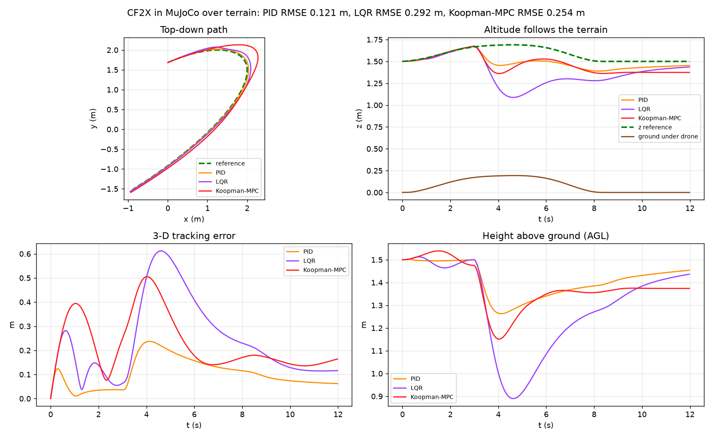

**Conditions:** $\delta_m = 0.40$, $F_w = 0.0\,\text{N}$.
**Results:** $\text{RMSE}_{\text{PID}} = 0.121\,\text{m}$, $\text{RMSE}_{\text{LQR}} = 0.292\,\text{m}$, $\text{RMSE}_{\text{Koopman-MPC}} = 0.254\,\text{m}$.
</details>

<details>
<summary><strong>comparison_canyon_payload0.4_wind0.015.png</strong> — $+40\%$ mass ($\delta_m = 0.40$), $F_w = 0.015\,\text{N}$</summary>

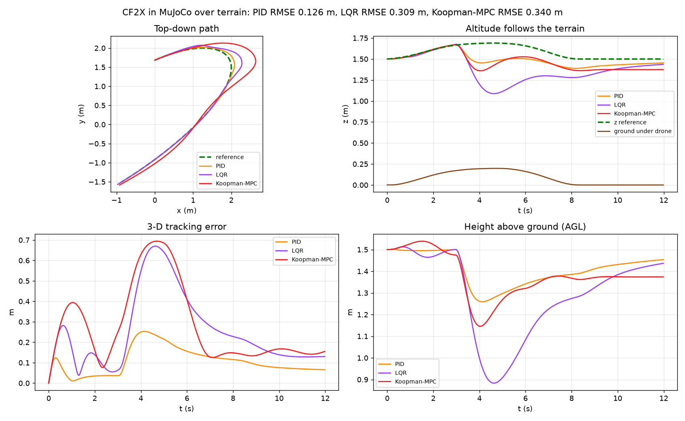

**Conditions:** $\delta_m = 0.40$, $F_w = 0.015\,\text{N}$.
**Results:** $\text{RMSE}_{\text{PID}} = 0.126\,\text{m}$, $\text{RMSE}_{\text{LQR}} = 0.309\,\text{m}$, $\text{RMSE}_{\text{Koopman-MPC}} = 0.340\,\text{m}$.
</details>

<details>
<summary><strong>comparison_canyon_payload0.4_wind0.03.png</strong> — $+40\%$ mass ($\delta_m = 0.40$), $F_w = 0.03\,\text{N}$</summary>

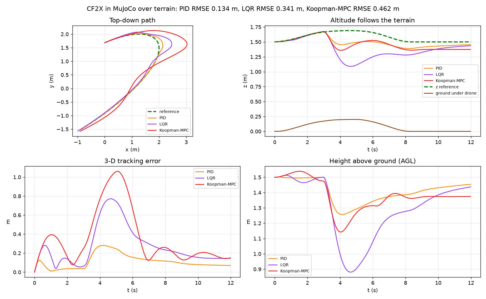

**Conditions:** $\delta_m = 0.40$, $F_w = 0.03\,\text{N}$.
**Results:** $\text{RMSE}_{\text{PID}} = 0.134\,\text{m}$, $\text{RMSE}_{\text{LQR}} = 0.341\,\text{m}$, $\text{RMSE}_{\text{Koopman-MPC}} = 0.462\,\text{m}$.
</details>

### Flat terrain

<details>
<summary><strong>comparison_flat_payload0.0_wind0.0.png</strong> — Nominal mass ($\delta_m = 0.0$), $F_w = 0.0\,\text{N}$</summary>

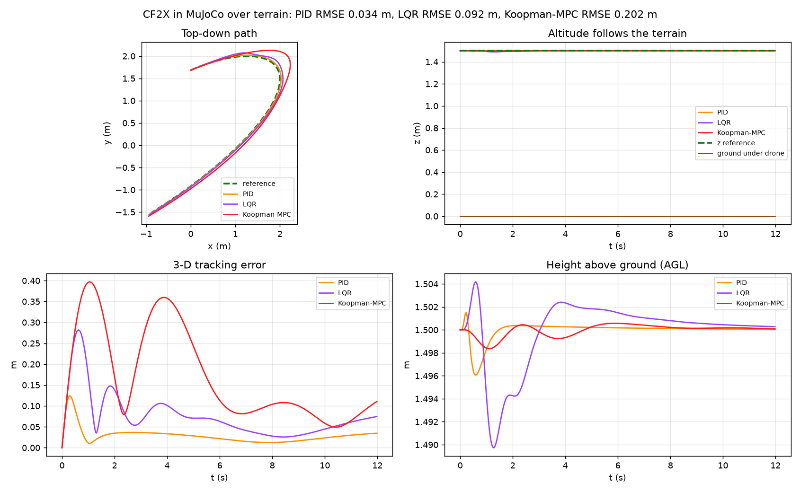

**Results:** $\text{RMSE}_{\text{PID}} = 0.034\,\text{m}$, $\text{RMSE}_{\text{LQR}} = 0.092\,\text{m}$, $\text{RMSE}_{\text{Koopman-MPC}} = 0.202\,\text{m}$.
</details>

<details>
<summary><strong>comparison_flat_payload0.0_wind0.015.png</strong> — Nominal mass ($\delta_m = 0.0$), $F_w = 0.015\,\text{N}$</summary>

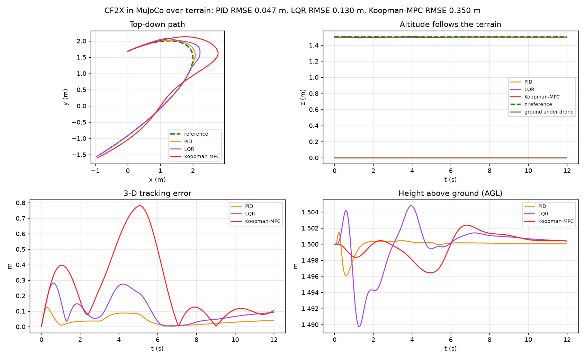

**Results:** $\text{RMSE}_{\text{PID}} = 0.047\,\text{m}$, $\text{RMSE}_{\text{LQR}} = 0.130\,\text{m}$, $\text{RMSE}_{\text{Koopman-MPC}} = 0.350\,\text{m}$.
</details>

<details>
<summary><strong>comparison_flat_payload0.0_wind0.03.png</strong> — Nominal mass ($\delta_m = 0.0$), $F_w = 0.03\,\text{N}$</summary>

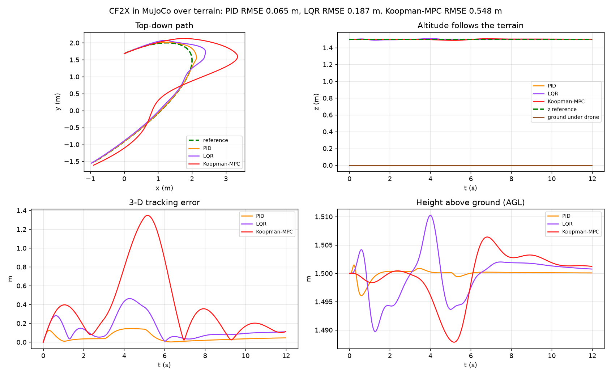

**Results:** $\text{RMSE}_{\text{PID}} = 0.065\,\text{m}$, $\text{RMSE}_{\text{LQR}} = 0.187\,\text{m}$, $\text{RMSE}_{\text{Koopman-MPC}} = 0.548\,\text{m}$.
</details>

<details>
<summary><strong>comparison_flat_payload0.2_wind0.0.png</strong> — $+20\%$ mass ($\delta_m = 0.20$), $F_w = 0.0\,\text{N}$</summary>

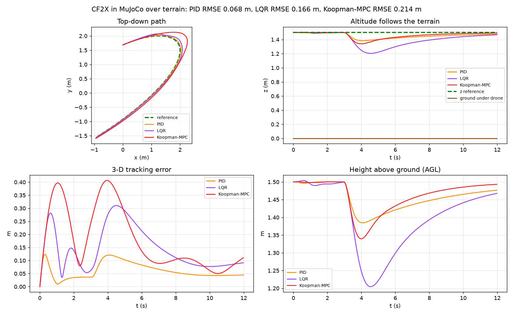

**Results:** $\text{RMSE}_{\text{PID}} = 0.068\,\text{m}$, $\text{RMSE}_{\text{LQR}} = 0.166\,\text{m}$, $\text{RMSE}_{\text{Koopman-MPC}} = 0.214\,\text{m}$.
</details>

<details>
<summary><strong>comparison_flat_payload0.2_wind0.015.png</strong> — $+20\%$ mass ($\delta_m = 0.20$), $F_w = 0.015\,\text{N}$</summary>

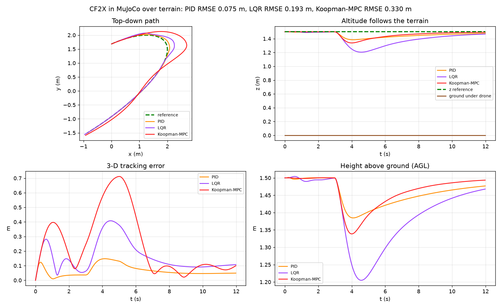

**Results:** $\text{RMSE}_{\text{PID}} = 0.075\,\text{m}$, $\text{RMSE}_{\text{LQR}} = 0.193\,\text{m}$, $\text{RMSE}_{\text{Koopman-MPC}} = 0.330\,\text{m}$.
</details>

<details>
<summary><strong>comparison_flat_payload0.2_wind0.03.png</strong> — $+20\%$ mass ($\delta_m = 0.20$), $F_w = 0.03\,\text{N}$</summary>

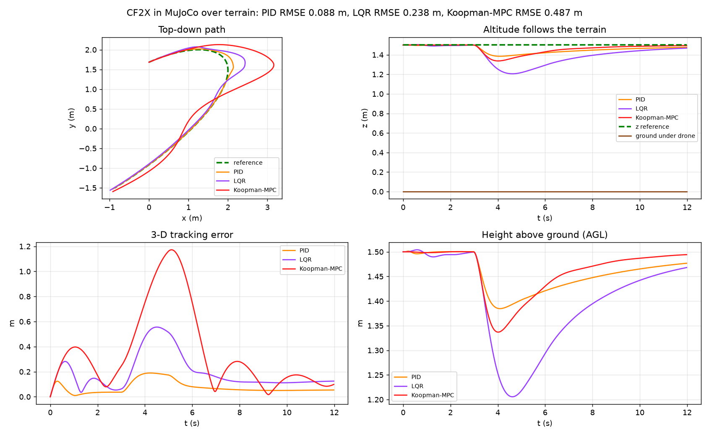

**Results:** $\text{RMSE}_{\text{PID}} = 0.088\,\text{m}$, $\text{RMSE}_{\text{LQR}} = 0.238\,\text{m}$, $\text{RMSE}_{\text{Koopman-MPC}} = 0.487\,\text{m}$.
</details>

<details>
<summary><strong>comparison_flat_payload0.4_wind0.0.png</strong> — $+40\%$ mass ($\delta_m = 0.40$), $F_w = 0.0\,\text{N}$</summary>

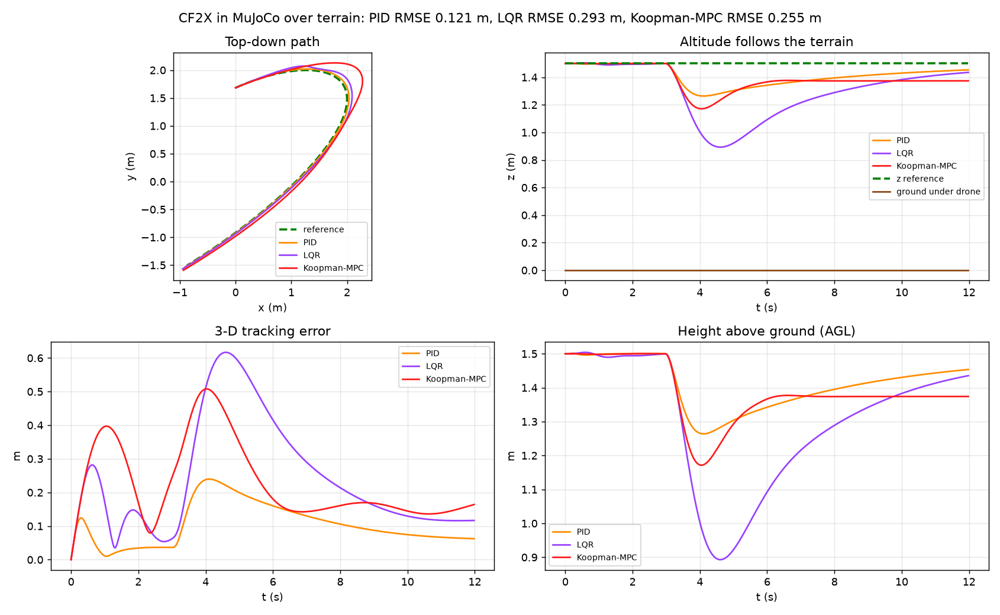

**Results:** $\text{RMSE}_{\text{PID}} = 0.121\,\text{m}$, $\text{RMSE}_{\text{LQR}} = 0.293\,\text{m}$, $\text{RMSE}_{\text{Koopman-MPC}} = 0.255\,\text{m}$.
</details>

<details>
<summary><strong>comparison_flat_payload0.4_wind0.015.png</strong> — $+40\%$ mass ($\delta_m = 0.40$), $F_w = 0.015\,\text{N}$</summary>

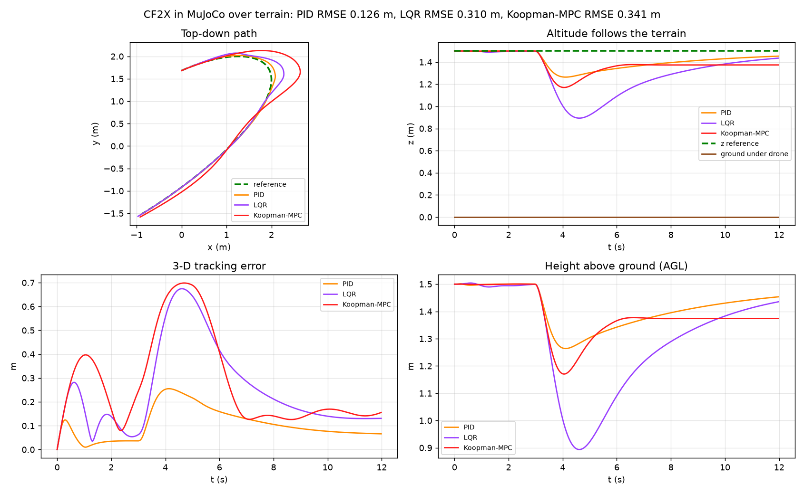

**Results:** $\text{RMSE}_{\text{PID}} = 0.126\,\text{m}$, $\text{RMSE}_{\text{LQR}} = 0.310\,\text{m}$, $\text{RMSE}_{\text{Koopman-MPC}} = 0.341\,\text{m}$.
</details>

<details>
<summary><strong>comparison_flat_payload0.4_wind0.03.png</strong> — $+40\%$ mass ($\delta_m = 0.40$), $F_w = 0.03\,\text{N}$</summary>

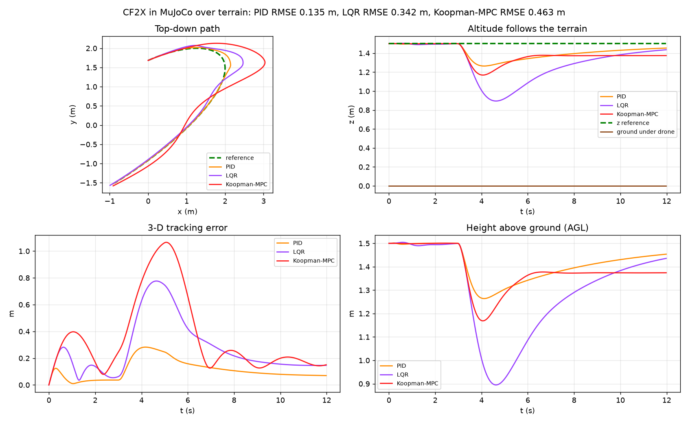

**Results:** $\text{RMSE}_{\text{PID}} = 0.135\,\text{m}$, $\text{RMSE}_{\text{LQR}} = 0.342\,\text{m}$, $\text{RMSE}_{\text{Koopman-MPC}} = 0.463\,\text{m}$.
</details>

### Mountain terrain

<details>
<summary><strong>comparison_mountain_payload0.0_wind0.0.png</strong> — Nominal mass ($\delta_m = 0.0$), $F_w = 0.0\,\text{N}$</summary>

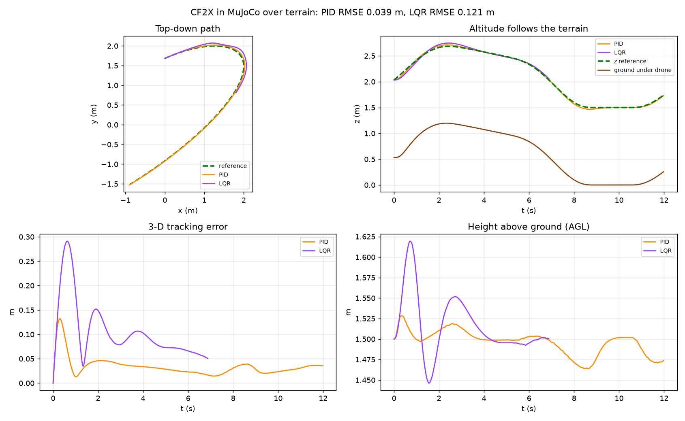

**Results:** $\text{RMSE}_{\text{PID}} = 0.039\,\text{m}$, $\text{RMSE}_{\text{LQR}} = 0.121\,\text{m}$ (PID and LQR trace).
</details>

<details>
<summary><strong>comparison_mountain_payload0.0_wind0.015.png</strong> — Nominal mass ($\delta_m = 0.0$), $F_w = 0.015\,\text{N}$</summary>

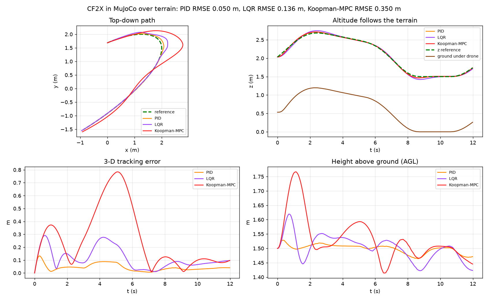

**Results:** $\text{RMSE}_{\text{PID}} = 0.050\,\text{m}$, $\text{RMSE}_{\text{LQR}} = 0.136\,\text{m}$, $\text{RMSE}_{\text{Koopman-MPC}} = 0.350\,\text{m}$.
</details>

<details>
<summary><strong>comparison_mountain_payload0.0_wind0.03.png</strong> — Nominal mass ($\delta_m = 0.0$), $F_w = 0.03\,\text{N}$</summary>

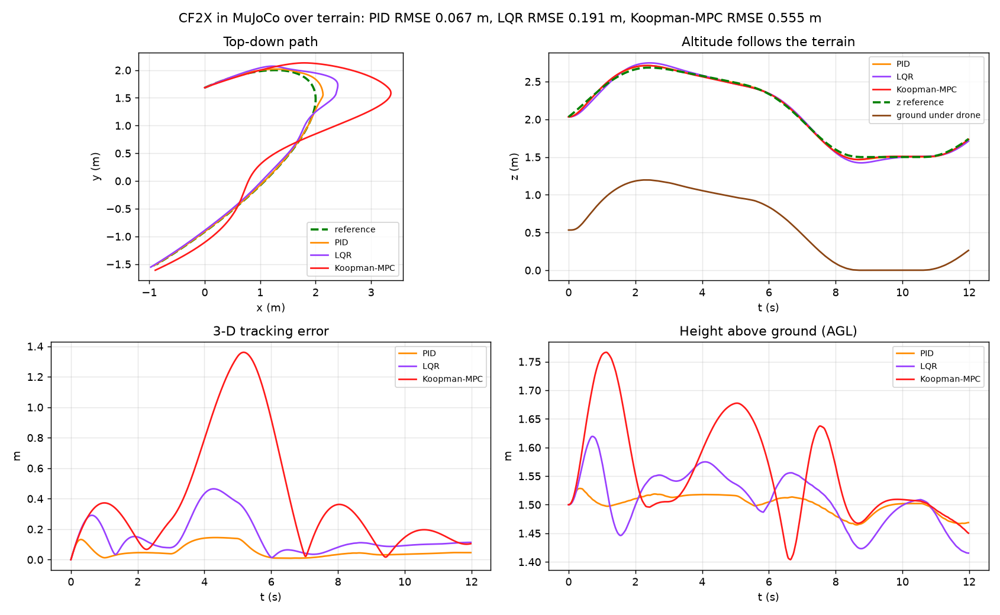

**Results:** $\text{RMSE}_{\text{PID}} = 0.067\,\text{m}$, $\text{RMSE}_{\text{LQR}} = 0.191\,\text{m}$, $\text{RMSE}_{\text{Koopman-MPC}} = 0.555\,\text{m}$.
</details>

<details>
<summary><strong>comparison_mountain_payload0.2_wind0.0.png</strong> — $+20\%$ mass ($\delta_m = 0.20$), $F_w = 0.0\,\text{N}$</summary>

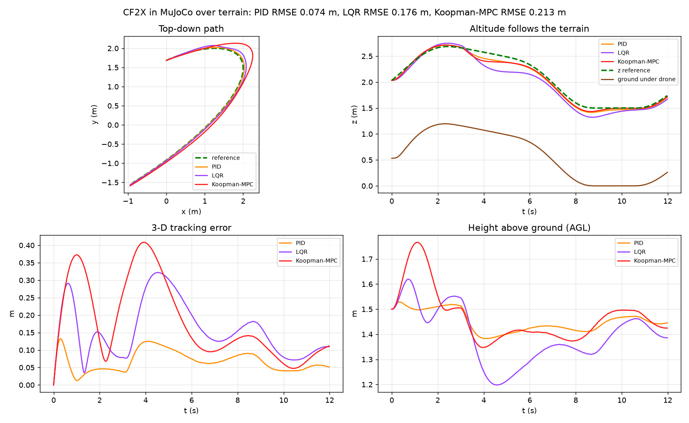

**Results:** $\text{RMSE}_{\text{PID}} = 0.074\,\text{m}$, $\text{RMSE}_{\text{LQR}} = 0.176\,\text{m}$, $\text{RMSE}_{\text{Koopman-MPC}} = 0.213\,\text{m}$.
</details>

<details>
<summary><strong>comparison_mountain_payload0.2_wind0.015.png</strong> — $+20\%$ mass ($\delta_m = 0.20$), $F_w = 0.015\,\text{N}$</summary>

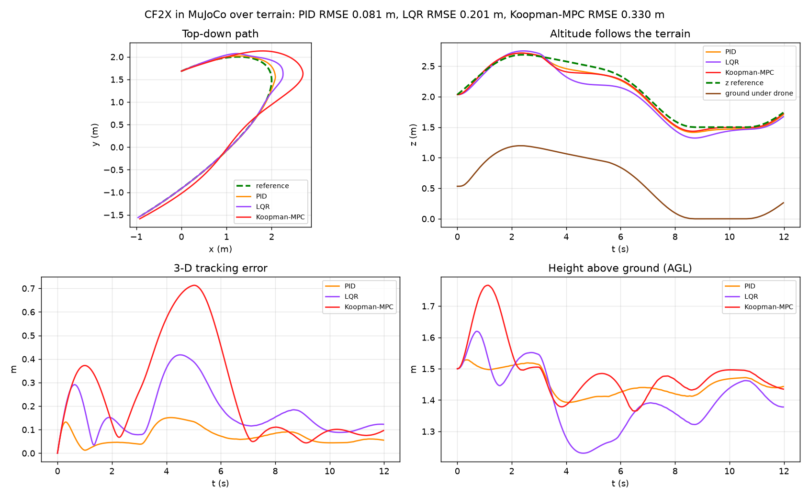

**Results:** $\text{RMSE}_{\text{PID}} = 0.081\,\text{m}$, $\text{RMSE}_{\text{LQR}} = 0.201\,\text{m}$, $\text{RMSE}_{\text{Koopman-MPC}} = 0.330\,\text{m}$.
</details>

<details>
<summary><strong>comparison_mountain_payload0.2_wind0.03.png</strong> — $+20\%$ mass ($\delta_m = 0.20$), $F_w = 0.03\,\text{N}$</summary>

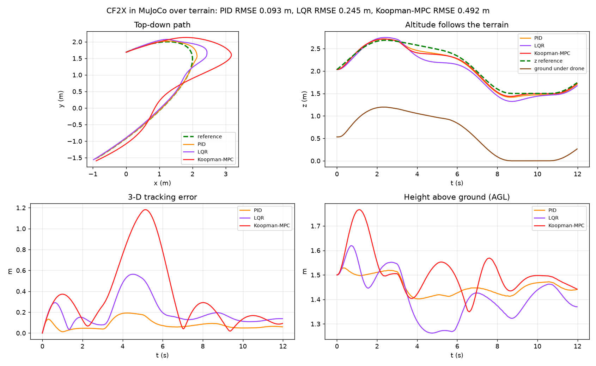

**Results:** $\text{RMSE}_{\text{PID}} = 0.093\,\text{m}$, $\text{RMSE}_{\text{LQR}} = 0.245\,\text{m}$, $\text{RMSE}_{\text{Koopman-MPC}} = 0.492\,\text{m}$.
</details>

<details>
<summary><strong>comparison_mountain_payload0.4_wind0.0.png</strong> — $+40\%$ mass ($\delta_m = 0.40$), $F_w = 0.0\,\text{N}$</summary>

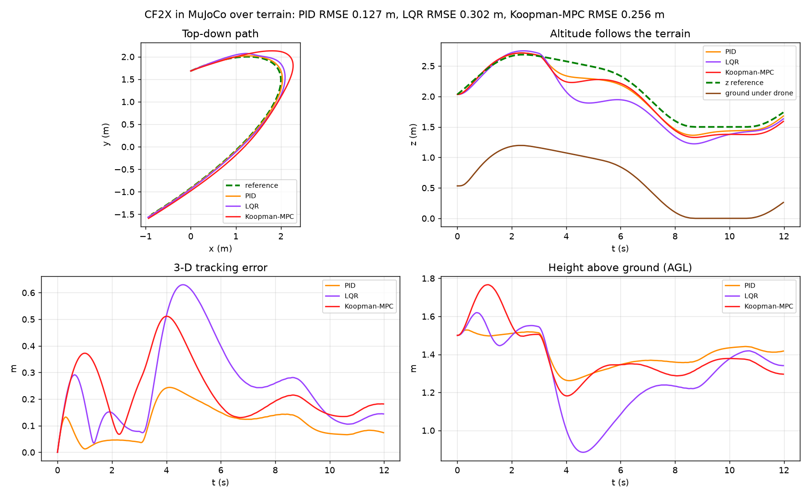

**Results:** $\text{RMSE}_{\text{PID}} = 0.127\,\text{m}$, $\text{RMSE}_{\text{LQR}} = 0.302\,\text{m}$, $\text{RMSE}_{\text{Koopman-MPC}} = 0.256\,\text{m}$.
</details>

<details>
<summary><strong>comparison_mountain_payload0.4_wind0.015.png</strong> — $+40\%$ mass ($\delta_m = 0.40$), $F_w = 0.015\,\text{N}$</summary>

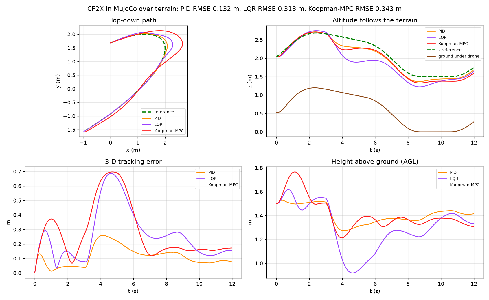

**Results:** $\text{RMSE}_{\text{PID}} = 0.132\,\text{m}$, $\text{RMSE}_{\text{LQR}} = 0.318\,\text{m}$, $\text{RMSE}_{\text{Koopman-MPC}} = 0.343\,\text{m}$.
</details>

<details>
<summary><strong>comparison_mountain_payload0.4_wind0.03.png</strong> — $+40\%$ mass ($\delta_m = 0.40$), $F_w = 0.03\,\text{N}$</summary>

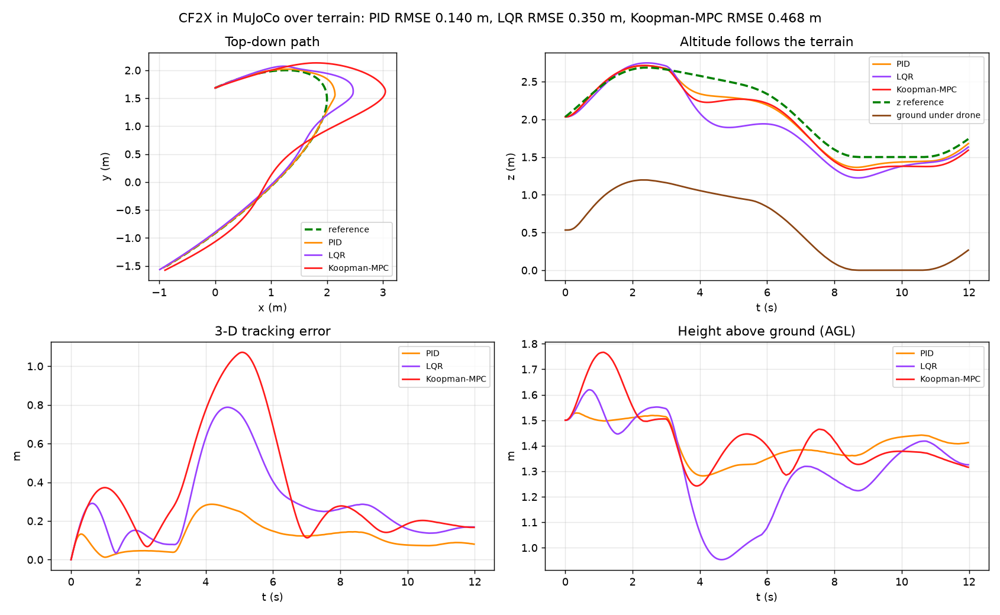

**Results:** $\text{RMSE}_{\text{PID}} = 0.140\,\text{m}$, $\text{RMSE}_{\text{LQR}} = 0.350\,\text{m}$, $\text{RMSE}_{\text{Koopman-MPC}} = 0.468\,\text{m}$.
</details>

### Rolling terrain

<details>
<summary><strong>comparison_rolling_payload0.0_wind0.0.png</strong> — Nominal mass ($\delta_m = 0.0$), $F_w = 0.0\,\text{N}$</summary>

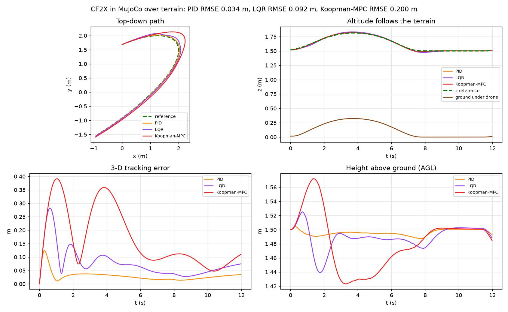

**Results:** $\text{RMSE}_{\text{PID}} = 0.034\,\text{m}$, $\text{RMSE}_{\text{LQR}} = 0.092\,\text{m}$, $\text{RMSE}_{\text{Koopman-MPC}} = 0.200\,\text{m}$.
</details>

<details>
<summary><strong>comparison_rolling_payload0.0_wind0.015.png</strong> — Nominal mass ($\delta_m = 0.0$), $F_w = 0.015\,\text{N}$</summary>

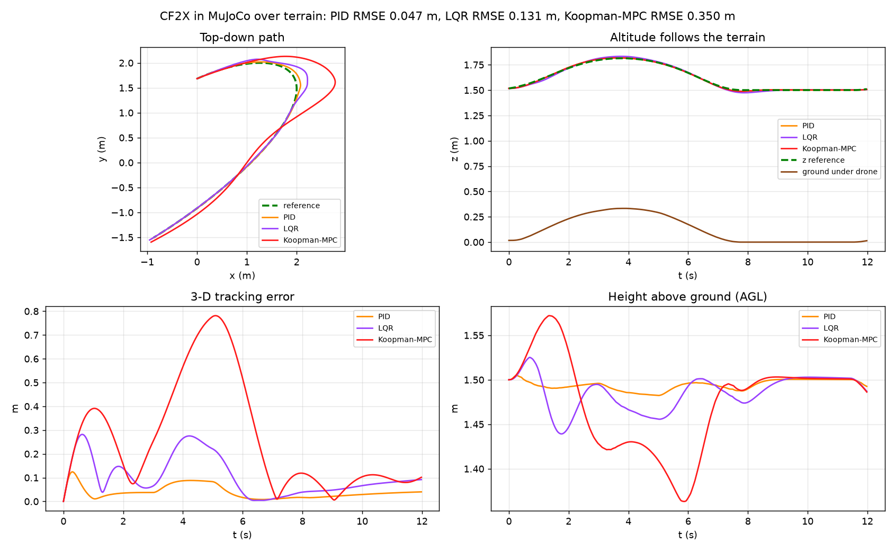

**Results:** $\text{RMSE}_{\text{PID}} = 0.047\,\text{m}$, $\text{RMSE}_{\text{LQR}} = 0.131\,\text{m}$, $\text{RMSE}_{\text{Koopman-MPC}} = 0.350\,\text{m}$.
</details>

<details>
<summary><strong>comparison_rolling_payload0.0_wind0.03.png</strong> — Nominal mass ($\delta_m = 0.0$), $F_w = 0.03\,\text{N}$</summary>

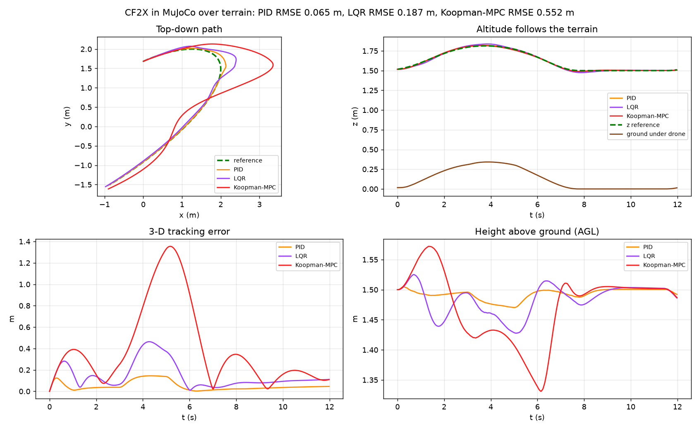

**Results:** $\text{RMSE}_{\text{PID}} = 0.065\,\text{m}$, $\text{RMSE}_{\text{LQR}} = 0.187\,\text{m}$, $\text{RMSE}_{\text{Koopman-MPC}} = 0.552\,\text{m}$.
</details>

<details>
<summary><strong>comparison_rolling_payload0.2_wind0.0.png</strong> — $+20\%$ mass ($\delta_m = 0.20$), $F_w = 0.0\,\text{N}$</summary>

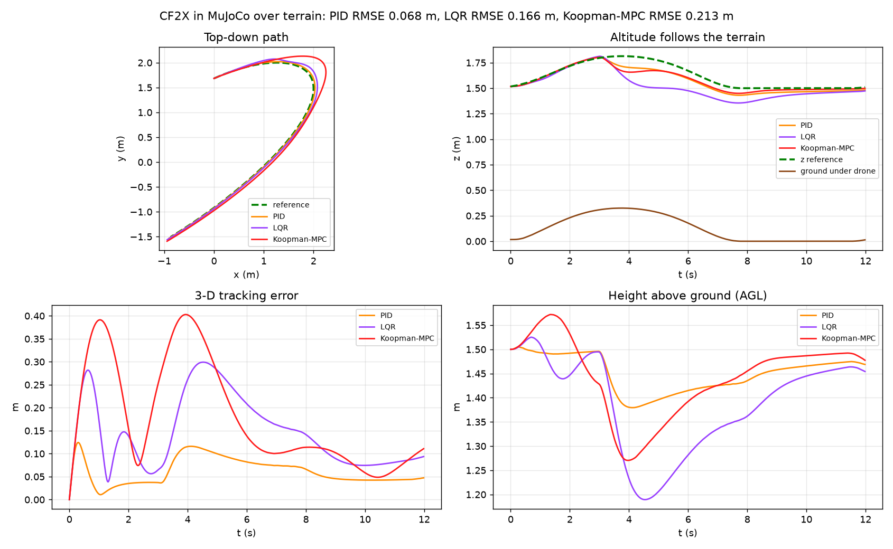

**Results:** $\text{RMSE}_{\text{PID}} = 0.068\,\text{m}$, $\text{RMSE}_{\text{LQR}} = 0.166\,\text{m}$, $\text{RMSE}_{\text{Koopman-MPC}} = 0.213\,\text{m}$.
</details>

<details>
<summary><strong>comparison_rolling_payload0.2_wind0.015.png</strong> — $+20\%$ mass ($\delta_m = 0.20$), $F_w = 0.015\,\text{N}$</summary>

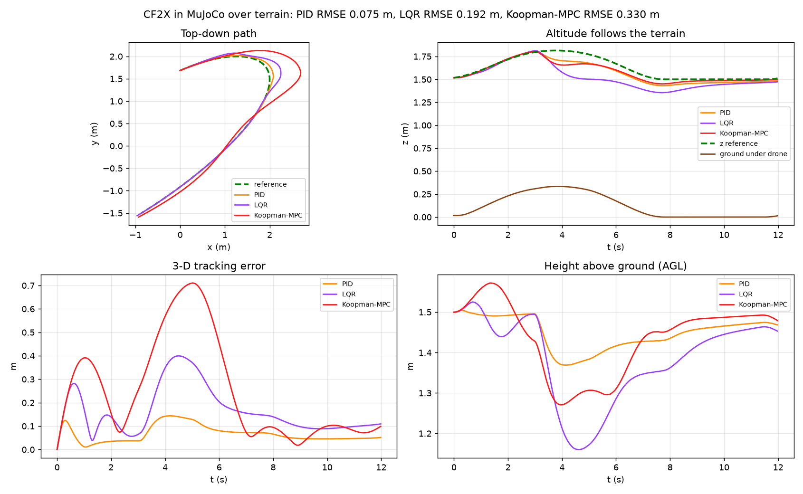

**Results:** $\text{RMSE}_{\text{PID}} = 0.075\,\text{m}$, $\text{RMSE}_{\text{LQR}} = 0.192\,\text{m}$, $\text{RMSE}_{\text{Koopman-MPC}} = 0.330\,\text{m}$.
</details>

<details>
<summary><strong>comparison_rolling_payload0.2_wind0.03.png</strong> — $+20\%$ mass ($\delta_m = 0.20$), $F_w = 0.03\,\text{N}$</summary>

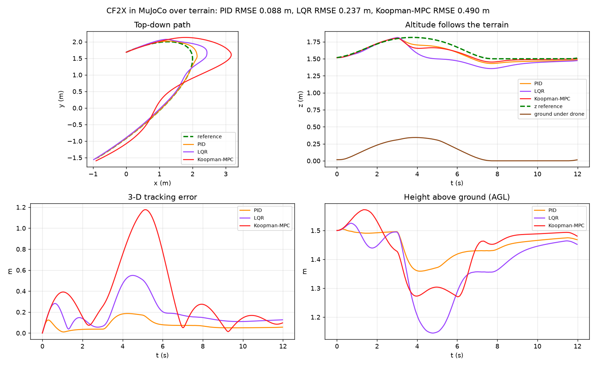

**Results:** $\text{RMSE}_{\text{PID}} = 0.088\,\text{m}$, $\text{RMSE}_{\text{LQR}} = 0.237\,\text{m}$, $\text{RMSE}_{\text{Koopman-MPC}} = 0.490\,\text{m}$.
</details>

<details>
<summary><strong>comparison_rolling_payload0.4_wind0.0.png</strong> — $+40\%$ mass ($\delta_m = 0.40$), $F_w = 0.0\,\text{N}$</summary>


**Results:** $\text{RMSE}_{\text{PID}} = 0.121\,\text{m}$, $\text{RMSE}_{\text{LQR}} = 0.291\,\text{m}$, $\text{RMSE}_{\text{Koopman-MPC}} = 0.254\,\text{m}$.
</details>

<details>
<summary><strong>comparison_rolling_payload0.4_wind0.015.png</strong> — $+40\%$ mass ($\delta_m = 0.40$), $F_w = 0.015\,\text{N}$</summary>

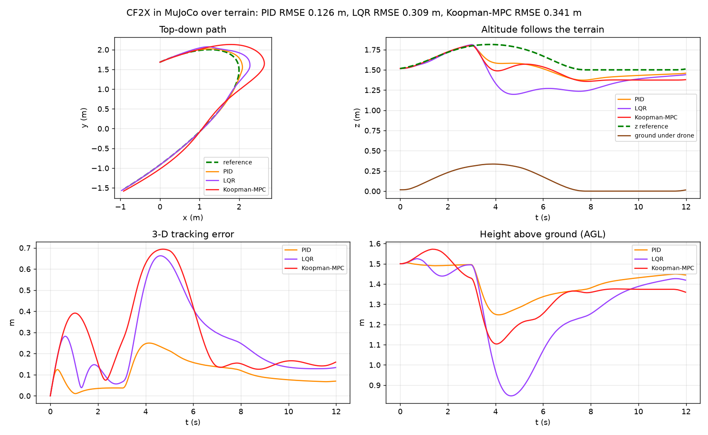

**Results:** $\text{RMSE}_{\text{PID}} = 0.126\,\text{m}$, $\text{RMSE}_{\text{LQR}} = 0.309\,\text{m}$, $\text{RMSE}_{\text{Koopman-MPC}} = 0.341\,\text{m}$.
</details>

<details>
<summary><strong>comparison_rolling_payload0.4_wind0.03.png</strong> — $+40\%$ mass ($\delta_m = 0.40$), $F_w = 0.03\,\text{N}$</summary>

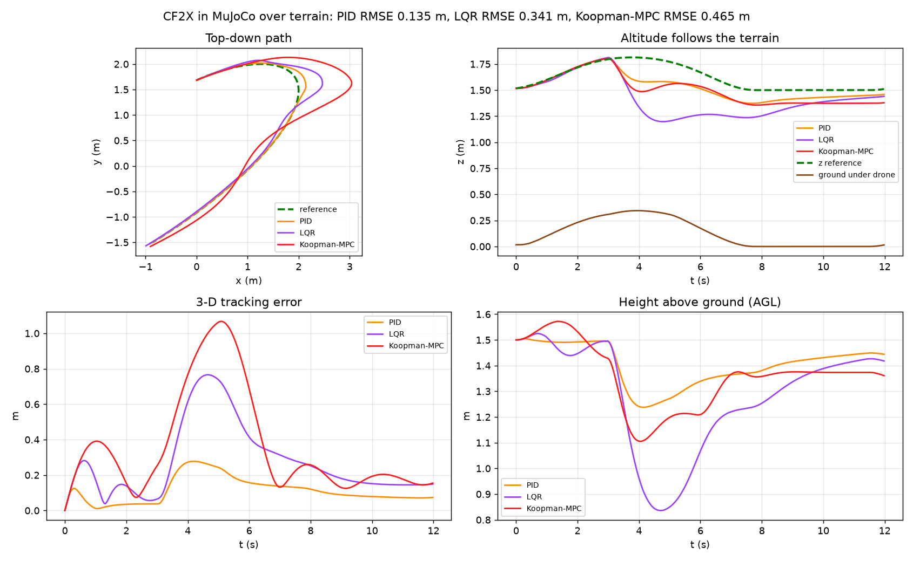

**Results:** $\text{RMSE}_{\text{PID}} = 0.135\,\text{m}$, $\text{RMSE}_{\text{LQR}} = 0.341\,\text{m}$, $\text{RMSE}_{\text{Koopman-MPC}} = 0.465\,\text{m}$.
</details>

---

## References

1. Koopman, B. O. (1931). “Hamiltonian Systems and Transformations in Hilbert Space.” *Proceedings of the National Academy of Sciences*, 17(5), 315–318. https://doi.org/10.1073/pnas.17.5.315
2. Williams, M. O., Kevrekidis, I. G., & Rowley, C. W. (2015). “A Data-Driven Approximation of the Koopman Operator: Extending Dynamic Mode Decomposition.” *Journal of Nonlinear Science*, 25, 1307–1346. https://doi.org/10.1007/s00332-015-9258-5
3. Korda, M., & Mezić, I. (2018). “Linear predictors for nonlinear dynamical systems: Koopman operator meets model predictive control.” *Automatica*, 93, 149–160. https://doi.org/10.1016/j.automatica.2018.03.046
4. Rawlings, J. B., Mayne, D. Q., & Diehl, M. (2022). *Model Predictive Control: Theory, Computation, and Design* (2nd ed.). Nob Hill Publishing. https://sites.engineering.ucsb.edu/~jbraw/mpc/
5. Todorov, E., Erez, T., & Tassa, Y. (2012). “MuJoCo: A physics engine for model-based control.” *2012 IEEE/RSJ International Conference on Intelligent Robots and Systems*, 5026–5033. https://doi.org/10.1109/IROS.2012.6386109
6. Google DeepMind. *MuJoCo Documentation*. https://mujoco.readthedocs.io/
7. CVXPY Developers. *CVXPY Documentation*. https://www.cvxpy.org/
8. Clarabel Contributors. *Clarabel Conic Interior Point Solver Documentation*. https://clarabel.org/
